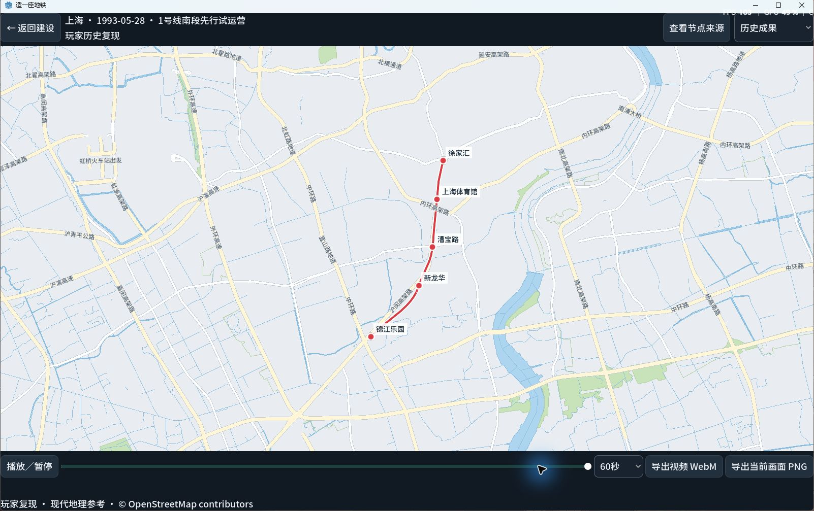
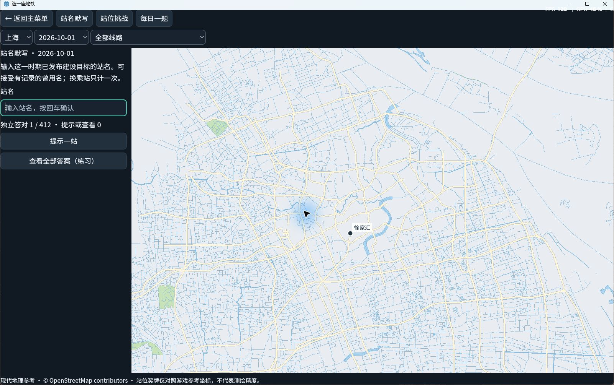

# 0.27.0 操作说明

历史建设仍是主线。新增挑战在主菜单进入，成绩独立保存；玩挑战不会修改正在建设的城市。

## 收藏自己的建设成果

1. 完成建设并确认历史节点。
2. 从故事时间轴或成果页进入“观看发展史”。
3. 用“播放／暂停”和进度条观看已确认节点；右上切换“历史成果／规划建设展示”。
4. 选30、60或120秒，点击“导出视频 WebM”，选择保存位置。等待“发展史视频已导出”才算成功；准备或编码期间可以取消。
5. 只要一张图时，点击“导出当前画面 PNG”。成果页的“线路图视图”另提供“保存PNG”。

回放不自动补建未完成章节。旧记录缺失时会说明能够恢复的范围。视频是1920×1080、30FPS的无声WebM；游戏里的合成报站不会录进视频。要向他人展示时，保留画面上的日期、资料精度和地图署名。

## 五题站位挑战

主菜单“地铁挑战”→“站位挑战”，选城市和时期。题目给出站名与线路，地图保留道路、水系和地标。

在地图点击答案位置，可以重选；点击“确认落点”后显示参考位置、偏差线和奖牌，再点“下一题”。提示会把本题标为练习。

奖牌只衡量相对**游戏参考坐标**的偏差：100米内金牌、250米内银牌、500米内铜牌。显示的约数与测绘精度无关；换乘题按题目指定的线路站体作答。

## 站名默写

主菜单“地铁挑战”→“站名默写”，选择城市、时期和线路。在“站名”输入框输入，按回车确认；答对后站点在地图亮起。

可以使用有记录的曾用名；同名异站需要再选择具体对象。换乘共同站点只计一次。“提示一站”与“查看全部答案（练习）”不算独立答对。关闭后重新进入可继续作答。

## 每日一题

进入“每日一题”，按题型选择答案或确认地图落点。日期按北京时间计算，相同题库版本、相同日期为同一题。

第一次结果保留，再玩计为练习。点击“导出分享卡 PNG”主动保存成绩图，默认不含答案。现有32题编排180天，会轮换复习，并非180道不同题；超过题库日期范围后改为普通练习。

## 声音、动画和保存

设置里的“展示列车播放普通话示意报站”可单独关闭；“减少建设动画”和建设提示音也可单独调整。合成声音不是实际运营方录音。

历史主线继续使用真实时间五分钟、有修改才覆盖的自动槽；手动保存和离开保护保留。挑战成绩存本地独立档案。免安装版请保留程序旁的`media`文件夹，否则不能导出视频。

五城资料完整性、已知内容缺口和未执行的人工检查请看[本轮更新说明](update-notes-0.27.0.md)与[测试记录](test-record.md)，不以挑战或收藏功能替代历史内容验收。
